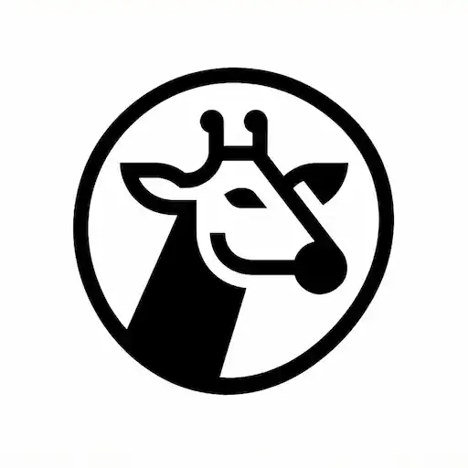

<div align="center">



# GiRAF

**Edit your RAW photos in the browser.**
**Your own server does the hard work.**

[](https://github.com/poesterlin/giraf/tags)
[](https://github.com/poesterlin/giraf/pkgs/container/giraf)
[](LICENSE)

[Quick start](#quick-start) · [Features](#features) · [Screenshots](#screenshots) · [Integrations](#integrations)

<br />


</div>

## Why GiRAF?

RAW editing usually needs a strong computer.
GiRAF runs the editing on your server instead.

- Your photos stay on your server.
- Any device with a browser can edit them, even an old tablet.
- Finished photos go straight to Immich or Google Photos.

GiRAF uses [RawTherapee](https://rawtherapee.com/) to process your photos.

## How it works

|     | Step       | What you do                                               |
| :-: | ---------- | --------------------------------------------------------- |
| 📥  | **Import** | Add photos from a folder, your device or an SD card.      |
| 🗂️  | **Sort**   | Pick your best shots. Hide the rest.                      |
| 🎨  | **Edit**   | Adjust light and color, add film looks, crop.             |
| 🚀  | **Share**  | Send photos to Immich or Google Photos, or download them. |

## Features

**Editing**

- Light, color and tone controls
- Film looks, previewed on your own photo
- Crop, masks and spot removal
- Automatic lens correction
- Undo, before/after view and saved versions
- Your original files are never changed

**Organizing**

- Photos are grouped into sessions
- Similar shots are stacked together
- Imports and exports run in the background

**Works anywhere**

- Edit on a phone, tablet or computer
- Quick previews on slow connections
- One Docker Compose file to install

## Screenshots

<table>
  <tr>
    <td width="50%"><p align="center"><b>Gallery</b></p></td>
    <td width="50%"><p align="center"><b>Session</b></p></td>
  </tr>
  <tr>
    <td><p align="center"><b>Film looks</b></p></td>
    <td><p align="center"><b>Import</b></p></td>
  </tr>
  <tr>
    <td><p align="center"><b>Export</b></p></td>
    <td align="center"><p align="center"><b>On a phone</b></p></td>
  </tr>
</table>

## Quick start

You need Docker with Docker Compose.
Run these four commands:

```bash
mkdir giraf && cd giraf
curl -O https://raw.githubusercontent.com/poesterlin/giraf/main/docker-compose.selfhost.yml
touch .env
docker compose -f docker-compose.selfhost.yml up -d
```

Now open [http://localhost:4893](http://localhost:4893).
On another device, use `http://<your-server-address>:4893`.

**Choose the export size and quality:** open **Settings** and pick a JPEG quality and a size.

**Add photos:** put RAW files in `./import` and press **Scan Directory**.
You can also press **Manual Upload**.

**Find exports:** they are saved in `./export`.

**Add film looks (optional):** download the [film look pack](http://rawtherapee.com/shared/HaldCLUT.zip).
Unzip it into `./cluts`.

## Configuration

- [All settings](docs/CONFIGURATION.md), including extra import folders and SD-card import
- [Uploading from your devices](docs/local-imports.md)
- [Uploading from the command line](docs/raw-upload-cli.md)

Storage paths and database settings are in `docker-compose.selfhost.yml`.

## Integrations

GiRAF can send finished photos to your photo library.

<details>
<summary><b>Immich</b></summary>

1. Create an **API key** in your Immich user settings. It needs permission to read albums and assets (for the album lookup and covers) and to create albums and upload assets.
2. Add it to your `.env`:
   ```bash
   IMMICH_BASE_URL=https://immich.example.com
   IMMICH_API_KEY=your-api-key
   ```

</details>

<details>
<summary><b>Google Photos</b></summary>

1. Create a project in the [Google Cloud Console](https://console.cloud.google.com/).
2. Enable the **Photos Library API**.
3. Create an **OAuth 2.0 Client ID** of type _Web application_.
4. Add your GiRAF URL followed by `/api/auth/google/callback` as a **redirect URI**, for example `https://photos.example.com/api/auth/google/callback`.
5. Add the credentials to your `.env`:
   ```bash
   GOOGLE_CLIENT_ID=...
   GOOGLE_CLIENT_SECRET=...
   ```

GiRAF keeps your Google login in `./data`.
The self-hosting compose file already sets this up.
If you use your own compose file, add this volume:

```yaml
services:
  editor:
    volumes:
      - ./data:/app/data
```

</details>

## License

GiRAF is free software under the [GNU GPL v3](LICENSE).
