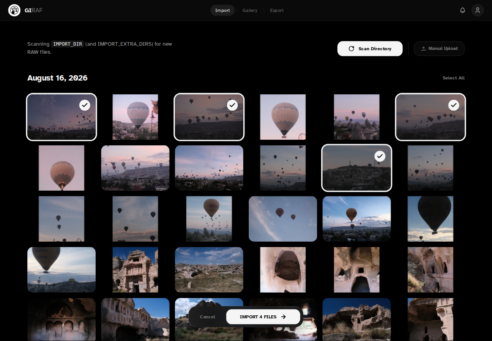
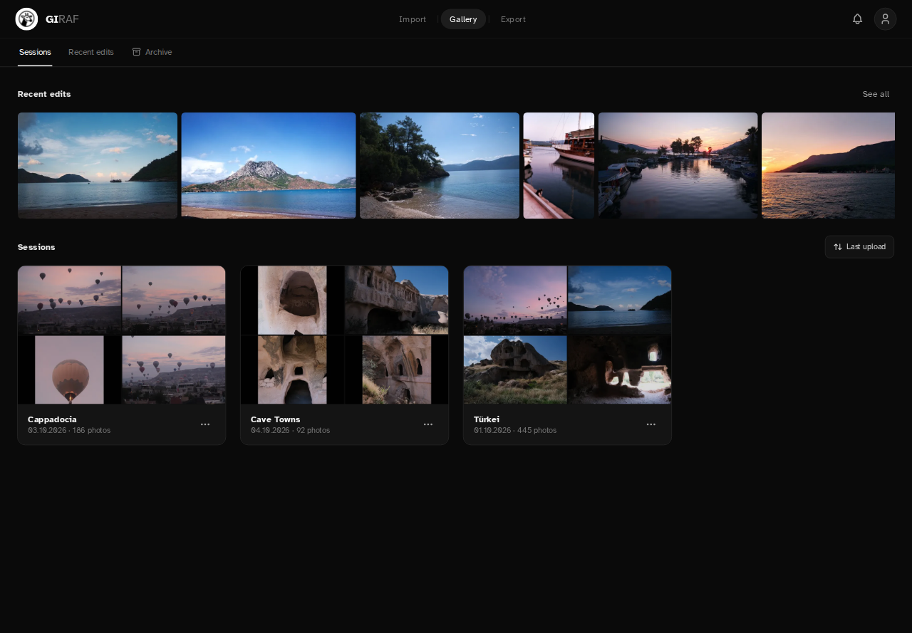
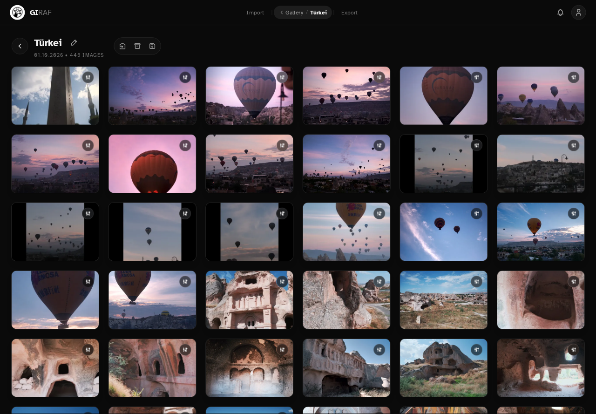
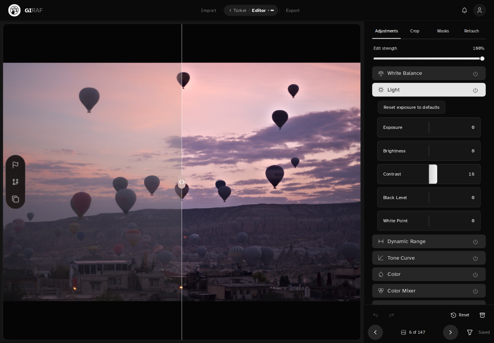
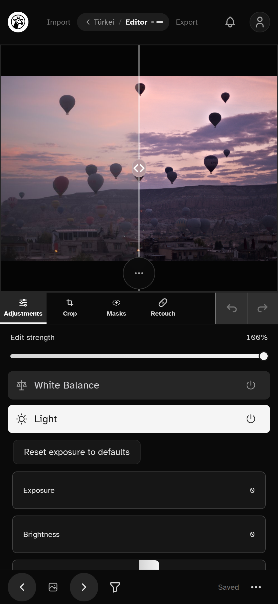
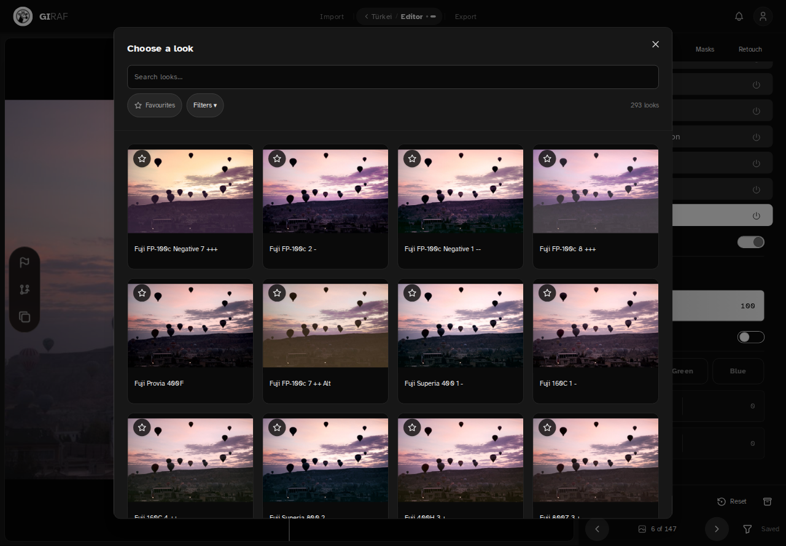
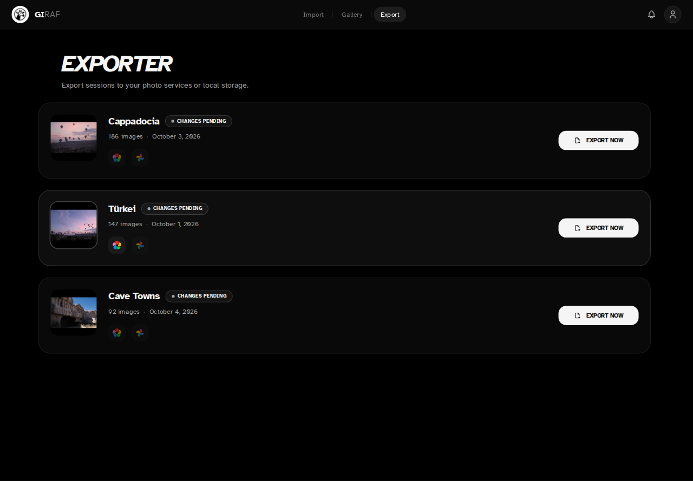

# GiRAF

**Develop your RAW photos from any browser, on your own server, and publish directly to Immich.**

GiRAF is a self-hosted RAW photo editor powered by [RawTherapee](https://rawtherapee.com/). Edit from a tablet or lightweight laptop while your server handles RAW processing and stores your photo collection—no desktop editor required on the device you use to edit.

Built for photographers with a self-hosted photo library, GiRAF brings importing, culling, non-destructive editing, and exporting into one browser-based workflow.

## Your workflow

1. **Import** RAW files from your server's import directory or upload them from your device.
2. **Cull** a session in Triage, inspect camera metadata, and archive the shots you don't want to keep in the active workflow.
3. **Develop** your selections with before/after comparison, film looks, local adjustments, and versioned snapshots.
4. **Publish** finished photos to Immich or Google Photos, or keep local exports and download completed sessions as ZIP files.

## Highlights

- **Your server, your library:** Docker-based self-hosting with server-side RawTherapee processing.
- **Browser-based, touch-friendly editing:** work from a tablet, laptop, or desktop without installing a RAW editor on each device.
- **Session-based organization and triage:** browse thumbnails, inspect EXIF metadata, and cull before editing.
- **Non-destructive adjustments:** exposure, black and white point, white balance, tone curves, color mixing and grading, black & white, noise reduction, sharpening, vignette, and film simulation LUTs.
- **Local editing tools:** crop and rotate, local masks, and spot retouching.
- **Automatic lens correction:** distortion, vignetting and chromatic aberration are corrected on import using lensfun. Re-importing a session brings older photos up to date.
- **Room to experiment:** undo/redo, before/after comparison, versioned snapshots, and reusable profiles.
- **Flexible import:** upload from the browser, scan extra folders (`IMPORT_EXTRA_DIRS`), or copy new photos from an SD card automatically (opt-in `sd-card` compose profile).
- **Background import and export:** processing notifications, export previews, and direct integrations with Immich and Google Photos.

## Screenshots

### 1. Import


### 2. Gallery



### 3. Editor




### 4. Export


## Quick start

1) Download [docker-compose.selfhost.yml](https://raw.githubusercontent.com/poesterlin/giraf/main/docker-compose.selfhost.yml) into a new folder.

2) Create an empty env file:

Use this file to configure the optional export integrations described below.

```bash
touch .env
```

3) Start the stack (app + PostgreSQL):

```bash
docker compose -f docker-compose.selfhost.yml up -d
```

4) Optionally add film emulation profiles. Download the [Hald CLUT pack](http://rawtherapee.com/shared/HaldCLUT.zip) and unzip it into `./cluts`.

5) Open [http://localhost:4893](http://localhost:4893), or `http://<your-server-address>:4893` from another device that can reach your server.

Place RAW files in `./import` and use **Scan Directory**, or use **Manual Upload** in the importer. Local exports are stored in `./export`.

## Configuration

- Edit `docker-compose.selfhost.yml` for database settings and storage paths when using the quick start.
- See [docs/CONFIGURATION.md](docs/CONFIGURATION.md) for environment variables.
- See [docs/local-imports.md](docs/local-imports.md) for device uploads and [docs/raw-upload-cli.md](docs/raw-upload-cli.md) for command-line uploads.

## Integrations

GiRAF supports exporting to external photo management services.

### Immich

1) Get an **API Key** from your Immich user settings.
2) Add the following to your `.env`:
   - `IMMICH_BASE_URL`: Your Immich instance URL (e.g., `https://immich.example.com`)
   - `IMMICH_API_KEY`: Your generated API key

### Google Photos

1) Create a project in the [Google Cloud Console](https://console.cloud.google.com/).
2) Enable the **Photos Library API**.
3) Create an **OAuth 2.0 Client ID** (Type: Web Application).
4) Add your full GiRAF URL followed by `/api/auth/google/callback` as a **Redirect URI** (e.g., `https://photos.example.com/api/auth/google/callback`).
5) Add the following to your `.env`:
   - `GOOGLE_CLIENT_ID`
   - `GOOGLE_CLIENT_SECRET`

#### Token Persistence (Self-Hosting)

When you authenticate with Google, tokens are saved to `/app/data/google_tokens.json` inside the container. The self-hosting compose file already maps `./data:/app/data` to persist them across container restarts. If you use a custom compose file, include this volume:

```yaml
services:
  editor:
    # ...
    volumes:
      - ./data:/app/data
```

## Roadmap

- [ ] User authentication
- [x] Undo/Redo functionality
- [x] Processing notifications
- [x] Tone curves
- [x] Vibrance controls (Muted Saturation)
- [x] Color grading
- [x] Color mixer (HSV adjustments)
- [x] Crop, local masks, and spot retouching
- [x] Progressive editor previews (quick preview followed by refinement on supported devices/connections)
- More editing tools
   - [x] Black level
   - [x] White point control
   - [x] Automatic lens corrections (lensfun, applied on import)
- [x] Multiple import directories (`IMPORT_EXTRA_DIRS`)
- [ ] Import directories configurable in the UI
- [x] Automatic SD-card import (opt-in `sd-card` compose profile)

## License

See `LICENSE` for GPLv3 terms.
